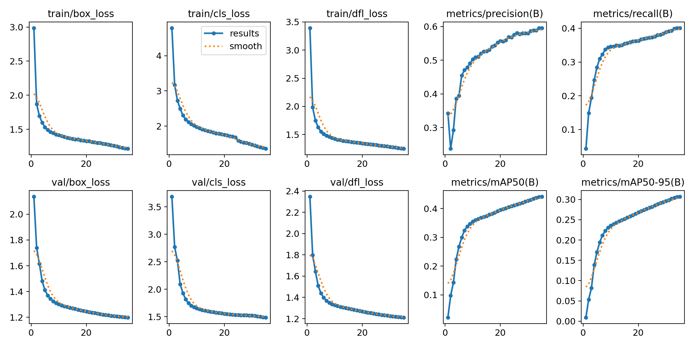
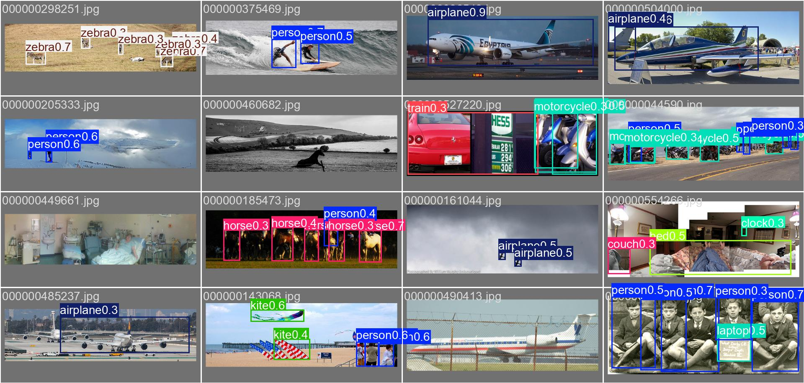
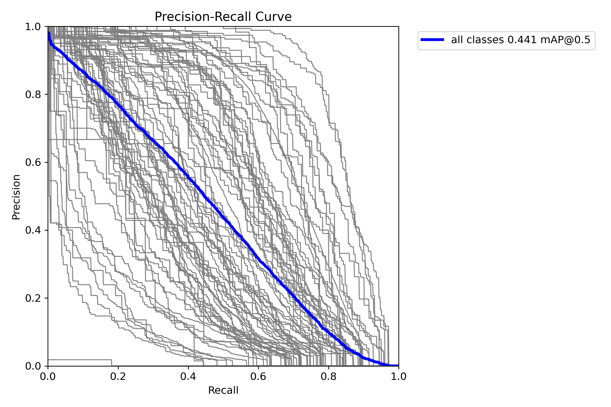
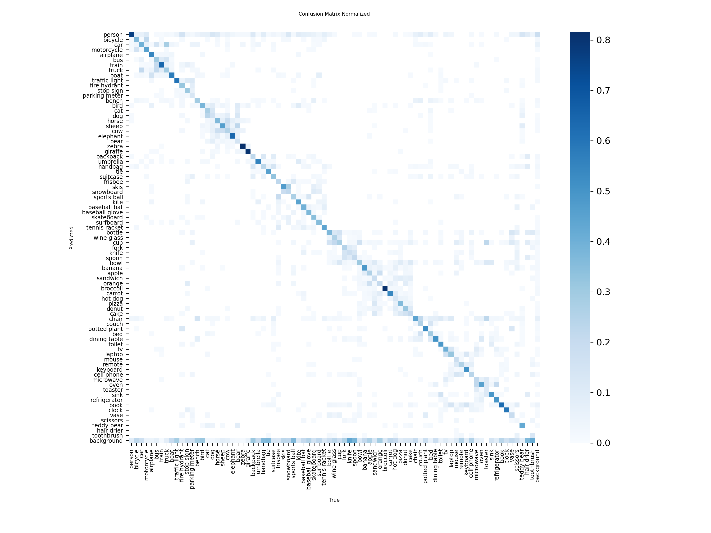

# YOLO11 from Scratch on COCO 2017 (Kaggle)

An end-to-end Kaggle notebook that trains an Ultralytics **YOLO11n** object detector on **COCO 2017 from random initialization** (no pretrained weights), evaluates it on `val2017` with the official COCO protocol, and reports detection metrics, per-class results and speed.

**Headline result:** **31.2 mAP@50-95** and **44.7 mAP@50** on val2017 after only **35 epochs** (about 9 hours on 2x Tesla T4), roughly 79% of the official pretrained YOLO11n (39.5 mAP@50-95), which was trained for far longer.

**Executed notebook with all outputs (training logs, curves, plots):** [View the run on Kaggle](https://www.kaggle.com/code/mohamedatta22/yolo-coco)

> **Why from scratch?** Official YOLO checkpoints are already trained on COCO, so evaluating them on COCO says nothing about our training. This pipeline builds the model from its architecture `.yaml` only, so every number below comes from this run.

---

## Results

Evaluated on the 5,000 COCO `val2017` images (never used for training), input size 640, `conf=0.001`, `iou=0.7`.

| Model | Pretrained | Epochs | Image size | mAP50-95 | mAP50 | mAP75 | Params | GFLOPs |
|-------|-----------|--------|-----------|----------|-------|-------|--------|--------|
| YOLO11n (this repo) | No | 35 | 640 | **31.2** | **44.7** | **33.6** | 2.62 M | 6.7 |
| YOLO11n (official reference) | COCO | several hundred | 640 | 39.5 | n/a | n/a | 2.6 M | 6.6 |

The official COCO numbers above are from `pycocotools`. Ultralytics' built-in estimate for the same weights is slightly lower (30.7 / 44.1 / 33.1).

### Official COCO metrics (pycocotools, bbox)

| Metric | Value |
|--------|-------|
| AP @[.50:.95], all | 0.3117 |
| AP @.50 | 0.4470 |
| AP @.75 | 0.3357 |
| AP small | 0.1449 |
| AP medium | 0.3410 |
| AP large | 0.4569 |
| AR @1 | 0.2881 |
| AR @10 | 0.4837 |
| AR @100 | 0.5376 |
| AR small | 0.2925 |
| AR medium | 0.5946 |
| AR large | 0.7406 |

### Ultralytics detection metrics

| Precision | Recall | Mean F1 |
|-----------|--------|---------|
| 0.593 | 0.402 | 0.452 |

### Speed (validation run, Tesla T4, PyTorch, FP16, batch 32, per image)

| Preprocess | Inference | Postprocess |
|-----------|-----------|-------------|
| 0.68 ms | 13.14 ms | 1.05 ms |

These are plain PyTorch numbers, not TensorRT, so don't compare them with latency figures published for exported engines.

### Discussion

- **Competitive for the budget.** Reaching about 79% of the fully trained reference in 35 epochs is a strong result for a from-scratch run, helped by a time-budgeted schedule (the learning rate decays fully and mosaic augmentation turns off at the end of the budget).
- **Small objects are the weak spot.** AP small (14.5) is far below AP large (45.7), a known limitation of a 2.6 M-parameter model at 640 px.
- **Accuracy is limited by training time, not by the setup.** The run is CPU-bound on Kaggle's 4 cores (JPEG decoding and mosaic augmentation), so more epochs would need more sessions or a machine with more cores.
- Verifiably from scratch. `results/training_history.csv` and the training curves show the first epochs starting near zero mAP, unlike a pretrained model.

---

### Visual results
Training curves (losses and validation metrics per epoch)

Sample predictions on val2017 images:

Precision-recall curve and normalized confusion matrix
<p align="center">
  
  
 </p>
 Per-class numbers are in results/per_class_metrics.csv

## Features

- Random-init model built from `yolo11n.yaml` (swappable for other sizes or YOLO versions)
- Guards against accidental pretrained weights (`.yaml` only, `pretrained=False`, assertion that no checkpoint is loaded)
- Automatic COCO to YOLO label conversion (91 to 80 classes), with images symlinked from `/kaggle/input` so the 20 GB working-directory limit is not hit
- Time-budgeted training (`TIME_HOURS`) so the schedule fits the available session time
- Multi-GPU (2x T4, DDP) and mixed precision (AMP)
- Checkpoint resume option
- Full evaluation: mAP, precision, recall, F1, official `pycocotools` AP/AR by object size, per-class table, PR/F1/confusion-matrix plots, speed and model size
- Smoke-test mode to validate the pipeline in minutes

## Pipeline

```
COCO 2017 (Kaggle dataset)
        |
        v
1. Convert annotations -> YOLO txt labels, build train/val image lists
        |
        v
2. Train YOLO11n from random weights  (time- or epoch-budgeted)
        |
        v
3. Evaluate best.pt on val2017  (Ultralytics + pycocotools)
        |
        v
4. Curves, per-class AP, sample predictions, saved weights and metrics
```

## Repository contents
.
├── README.md
├── yolo_coco_from_scratch_kaggle.ipynb
├── results/   (metrics_summary.json, coco_official_metrics.csv,
│               per_class_metrics.csv, training_history.csv)
└── assets/    (results.png, val_batch0_pred.jpg,
                BoxPR_curve.png, confusion_matrix_normalized.png)

This repository holds the clean source. The notebook with the real training logs, plots and metrics from the reported run is published on Kaggle: [executed run](https://www.kaggle.com/code/mohamedatta22/yolo-coco). Every number in this README comes from that run.

## Reproducing the reported run

1. Create a new Kaggle notebook and **upload** `yolo_coco_from_scratch_kaggle.ipynb` (File -> Import Notebook), or open the [executed run](https://www.kaggle.com/code/mohamedatta22/yolo-coco) and click **Copy & Edit**.
2. In the notebook settings:
   - **Accelerator:** GPU T4 x2
   - **Internet:** On (needed for `pip install` and plot fonts)
3. **Add Data:** search for **"COCO 2017 Dataset"** (`awsaf49/coco-2017-dataset`) and attach it.
4. Optional: run once with `QUICK_TEST = True` to confirm everything works (2% of the data, 3 epochs).
5. Keep the default config below, set `QUICK_TEST = False`, and run **Save Version -> Save & Run All (Commit)**. Kaggle allows up to 12 hours per session.

Configuration used for the reported result:

| Setting | Value |
|---------|-------|
| `MODEL_CFG` | `yolo11n.yaml` |
| `IMGSZ` | `640` |
| `BATCH` | `64` (total, across 2 GPUs) |
| `WORKERS` | `4` |
| `TIME_HOURS` | `9.0` |
| `FRACTION` | `1.0` |
| `USE_BOTH_GPUS` | `True` |
| Mixed precision | on (`amp=True`) |
| Seed | `0` |

**Reproducibility notes.** The pipeline is fully scripted and the seed is fixed, but results will not be bit-identical between runs: training uses `deterministic=False` for speed, and because the schedule is *time-budgeted*, the number of epochs you get depends on the hardware throughput of your session (35 epochs in the reported run). For an exact schedule, set `TIME_HOURS = None` and a fixed `EPOCHS`.

## Configuration reference

All options are in the **Config** cell:

| Variable | Default | Meaning |
|----------|---------|---------|
| `MODEL_CFG` | `yolo11n.yaml` | Architecture only (random weights). Use another `.yaml`, e.g. `yolo11s.yaml` or `yolov8n.yaml`. A `.pt` file is rejected on purpose. |
| `IMGSZ` | `640` | Training and evaluation image size |
| `BATCH` | `64` | Total batch size (split across GPUs) |
| `WORKERS` | `4` | Data-loader workers (Kaggle has 4 CPU cores) |
| `TIME_HOURS` | `9.0` | Training time budget; set `None` to use `EPOCHS` instead |
| `EPOCHS` | `300` | Used only when `TIME_HOURS` is `None` |
| `FRACTION` | `1.0` | Fraction of `train2017` to train on |
| `USE_BOTH_GPUS` | `True` | Use DDP when 2 GPUs are available |
| `QUICK_TEST` | `False` | Smoke test: 2% of data, 3 epochs |
| `RESUME_CKPT` | `None` | Path to a `last.pt` to continue a previous run |
| `EXPORT_ONNX` | `False` | Also export the best model to ONNX |
| `CLEANUP` | `True` | Remove symlinks to `/kaggle/input` at the end so commits stay clean |

## Evaluation protocol

COCO `test2017` has no public ground truth, so the standard evaluation is on **`val2017`**. The notebook reports:

- **mAP50-95**, **mAP50**, **mAP75**
- **Precision**, **Recall**, **mean F1**
- **Official COCO metrics** via `pycocotools`: AP and AR at different IoUs, object sizes and max detections
- **Per-class** precision, recall, F1, AP50 and AP50-95 (best and worst classes, bar chart)
- PR curve, F1 curve and normalized confusion matrix
- Parameter count, GFLOPs and per-image speed
- Training and validation loss curves and metric history per epoch
- Qualitative predictions on random `val2017` images (and unlabeled `test2017` images)

## Output files

Saved to `/kaggle/working` when the notebook finishes:

| File | Content |
|------|---------|
| `best.pt` | Best weights (by validation fitness) |
| `last.pt` | Last checkpoint |
| `metrics_summary.json` | Headline metrics, speed, model size, official COCO stats |
| `coco_official_metrics.csv` | The 12 standard `pycocotools` numbers |
| `per_class_metrics.csv` | Per-class precision, recall, F1, AP |
| `training_history.csv` | Per-epoch losses and metrics |
| `runs/` | Ultralytics run folders (curves, plots, confusion matrix, predictions) |

## Improving the results

Training longer is the largest lever (the schedule here is about 35 epochs versus several hundred for the official model). Other options, roughly in order of cost:

1. Inference-time tricks such as a larger evaluation size or test-time augmentation
2. A larger model such as `yolo11s.yaml`
3. A longer fixed-epoch schedule resumed across sessions, or a machine with more CPU cores
4. Augmentation tuned for a short schedule

## Resuming a run

Resume support is implemented but was **not exercised** in the reported run, which finished in a single session. For multi-session training, use a fixed `EPOCHS` (with `TIME_HOURS = None`) so the schedule stays consistent:

1. Download `last.pt` from the finished run (or save the notebook output as a Kaggle dataset).
2. In a new session, attach it as input data.
3. Set `RESUME_CKPT = "/kaggle/input/<your-dataset>/last.pt"`, re-run the dataset-building section, then the training cell.

## Troubleshooting

| Problem | Fix |
|---------|-----|
| `COCO 2017 not found` | Attach the COCO 2017 dataset via **Add Data** |
| `No GPU found` | Settings -> Accelerator -> GPU |
| Plot or font download errors | Turn Internet **On** |
| Out-of-memory | Lower `BATCH` (e.g. 32) or `IMGSZ` |
| Multi-GPU (DDP) errors | Set `USE_BOTH_GPUS = False` |
| Very slow epochs | Expected on 4 CPU cores; reduce `FRACTION` or `IMGSZ` for experiments |
| Resuming after `CLEANUP` | Re-run the dataset-building section first (symlinks are removed at the end) |

Note: at the start of training, Ultralytics' mixed-precision check may try to download a small pretrained model purely to test AMP. That model is not used for training.

## Requirements

Installed automatically in the first notebook cell:

- `ultralytics` (YOLO11)
- `pycocotools`
- PyTorch, NumPy, pandas, matplotlib, PyYAML (preinstalled on Kaggle)

## Acknowledgements and licenses

- [Ultralytics](https://github.com/ultralytics/ultralytics) for the YOLO11 implementation (AGPL-3.0; check its license terms if you redistribute or deploy derived work)
- [COCO: Common Objects in Context](https://cocodataset.org) (Lin et al., 2014); annotations are licensed CC BY 4.0, and the images remain subject to the Flickr terms of use
- Kaggle dataset mirror: `awsaf49/coco-2017-dataset`


